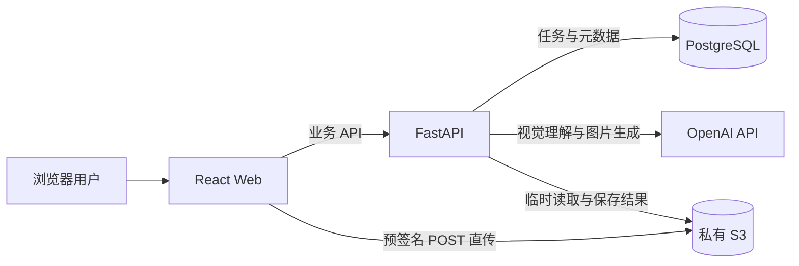

# 架构说明

## 目标与边界

本项目是一个可演示的 AI 图片创作平台，覆盖文字生成图片、基于参考图编辑、结果存储和历史记录管理。当前版本强调端到端业务闭环、清晰分层、失败可追踪和可重复交付。

当前版本不是生产级多租户平台：暂未包含登录授权、任务队列、限流、内容审核、多可用区部署和 RAG。

## 系统上下文



图片上传不经过 API 进程。FastAPI 只签发受文件类型、大小、路径和有效期约束的临时凭证，因此应用服务器不承担大文件转发流量，AWS 和 OpenAI 密钥也不会暴露给浏览器。

## 核心流程

### 文字生成图片

```text
POST /images/generations
  → 创建并提交 pending 记录
  → 调用图片生成模型
  → 上传生成结果到 S3
  → 更新记录为 completed
  → 返回临时预览地址
```

### 参考图编辑

```text
申请预签名表单
  → 浏览器直传参考图到 S3
  → 创建图片生成任务
  → 视觉模型分析参考图
  → 下载参考图并构造编辑提示词
  → 调用图片编辑模型
  → 结果上传 S3 并更新任务状态
```

### 失败恢复

任务会在调用外部服务前提交为 `pending`。OpenAI 或 S3 调用失败时，当前事务先回滚，再重新读取任务并标记为 `failed`。这样外部依赖故障不会留下完全不可见的任务。

当前状态机：

```text
pending ──成功──> completed
   │
   └──外部调用失败──> failed
```

## 后端分层

| 层 | 职责 |
| --- | --- |
| API Route | HTTP 参数、状态码和异常映射 |
| Service | 图片上传、分析、生成和状态流转编排 |
| Client | 隔离 OpenAI 与 boto3 SDK |
| Repository | SQLAlchemy 查询和事务操作 |
| Schema | API 输入输出约束 |
| Model | PostgreSQL 持久化模型 |

S3 与 OpenAI 客户端在进程内复用；Repository 跟随请求级数据库 Session，避免跨请求共享事务状态。同步 boto3 操作通过工作线程执行，避免阻塞 FastAPI 事件循环。

## 前端结构

React 页面负责渲染和事件绑定，ViewModel 负责编排 API 与页面状态。历史列表使用 Reducer 表达状态迁移，并用请求序号防止较早返回的请求覆盖最新页面数据。

## 数据模型

`image_generations` 保存以下信息：

- 原始用户提示词和实际发送给模型的最终提示词；
- 可选的参考图分析结果；
- 生成类型、输入和输出 S3 object key；
- 图片尺寸、任务状态和创建时间；
- 用于保留审计数据的软删除时间。

数据库变更由 Alembic 管理，容器启动时自动执行 `alembic upgrade head`。

## 安全边界

- S3 Bucket 保持私有，浏览器只获得短期预签名凭证；
- 后端只接受 `uploads/` 前缀下的参考图 object key；
- 密钥通过环境变量注入，不进入前端构建产物或 Git；
- Pydantic 限制提示词长度、图片类型和尺寸；
- CORS 只允许配置的前端来源。

## 可观测性

- `/health`：进程存活检查；
- `/health/database`：PostgreSQL 就绪检查；
- 每个请求返回 `X-Request-ID`；
- 应用日志采用单行 JSON，记录请求 ID、方法、路径、状态码和耗时；
- 容器编排对数据库、API 和 Web 分别配置健康检查。

## 自动化质量门禁

GitHub Actions 对每次 Pull Request 和 `main` 分支推送执行：

1. Ruff 后端静态检查；
2. Pytest 后端业务与健康检查测试；
3. ESLint 前端静态检查；
4. Vitest 前端状态机测试；
5. TypeScript 检查和 Vite 生产构建。

测试通过 Mock 隔离 OpenAI 与 S3，不需要真实云凭证，也不会产生模型费用。

## 生产化演进

如果进入真实生产环境，优先按以下顺序演进：

1. 将长耗时生成请求迁移到任务队列，增加幂等、重试和取消；
2. 增加身份认证、RBAC、租户隔离和审计日志；
3. 接入 Metrics、Trace、告警和模型成本监控；
4. 增加内容安全、配额、限流和数据保留策略；
5. 使用 IaC、托管数据库、对象生命周期和灾难恢复；
6. 在素材量达到需求后引入 pgvector/OpenCLIP 多模态检索。
